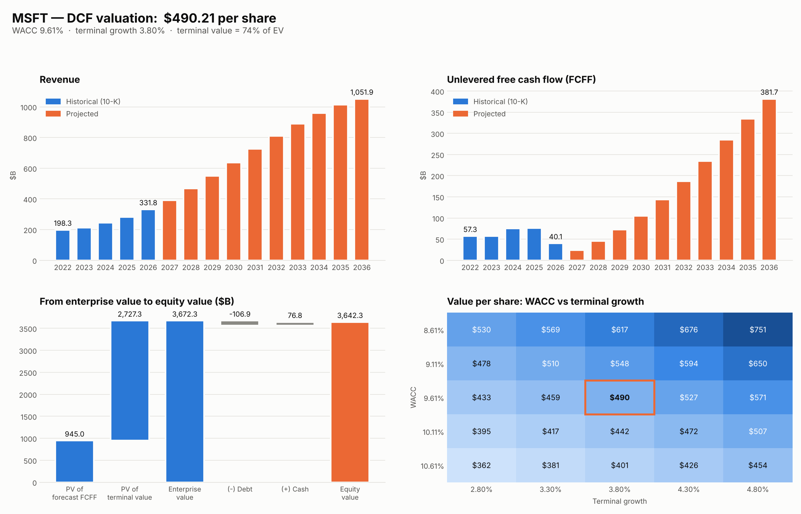

# dcf-valuation-model

DCF valuation of Microsoft in Python, using the numbers from its 10-K filings.

I built this to learn how a DCF actually works end to end: pulling the financials, projecting cash flows, figuring out the discount rate, and seeing how much the answer moves when you change one assumption. I tried to back every input with a source instead of using round numbers.



## Result

My base case gives **$490 per share**. MSFT closed at $529.05 on Oct 16, 2026, so the model comes out about 7% below the market.

| | |
|---|---|
| Enterprise value | $3.67T |
| WACC | 9.61% |
| Terminal growth | 3.8% |
| Terminal value as % of EV | 74% |

The number that matters most is CapEx. Microsoft went from spending 12% of revenue on capex in FY2022 to 35% in FY2026 (AI data centers). I assume it peaks in FY2027 and goes back to pre-AI levels over 10 years. If you think it stays high for longer, the value drops a lot. If it comes down faster, it goes up.

Not investment advice, just a modeling exercise.

## Assumptions

| | Value | Where it comes from |
|---|---|---|
| Revenue growth FY27 / FY28 | 17.9% / 19.7% | Analyst consensus on Yahoo Finance (~50 analysts) |
| Revenue growth after FY28 | fades to 3.8% by FY36 | No consensus that far out, so straight-line fade (Damodaran's approach) |
| Operating margin | 46% | FY26 was 46.8%, management said <1 pt decline in FY27 |
| Tax rate | 20% | FY27 guidance from the Q4 FY26 earnings call |
| D&A | 11.6% of revenue | FY26 cash flow statement |
| CapEx FY27 | ~$175B | Q1 FY27 guidance (over $50B), annualized, cash portion only |
| CapEx FY36 | 12.7% of revenue | Microsoft's own FY22-23 average |
| Risk-free rate | 5.09% | 10Y Treasury, Oct 16 2026 |
| Beta | 1.10 | 5Y monthly, Yahoo Finance |
| Equity risk premium | 4.23% | Damodaran implied ERP, Jan 2026 |
| Cost of debt | 6.05% | Moody's Aaa yield (FRED) |
| Terminal growth | 3.8% | CBO long-run real GDP (1.8%) + 2% inflation |

Debt includes finance leases ($66.6B), since a lot of the data centers are leased. Cash includes short-term investments.

The full reasoning for each number is in `data/msft_assumptions.json` and in the Sources tab of the Excel output.

Things I'm not fully happy with:
- D&A is kept flat as % of revenue. With this much capex it should probably go up, so the early cash flows might be a bit low.
- The fade after FY28 is my call, not data.
- The ERP is from January. Damodaran updates it monthly.

## How the model works

FCFF = EBIT × (1 − tax) + D&A − CapEx − change in working capital

Each year's FCFF is discounted at the WACC (CAPM for cost of equity, after-tax cost of debt, market value weights). Terminal value uses the Gordon growth formula. Then enterprise value − debt + cash = equity value, divided by shares outstanding.

There's also a sensitivity table (WACC vs terminal growth) because the result is very sensitive to both.

## Running it

```
python -m venv .venv
.venv\Scripts\activate
pip install -r requirements.txt

python main.py --csv data/msft_10k.csv --name MSFT --assumptions data/msft_assumptions.json
```

Other options:
- `python main.py --sample` runs a fake company, no internet needed
- `python main.py --ticker AAPL` pulls any US company live from SEC EDGAR (you need to set `SEC_USER_AGENT` to your name and email first, SEC requires it)
- `python -m pytest` runs the tests

It writes an Excel file and a PNG to `output/`.

## Files

- `dcf/edgar.py` downloads and parses SEC data
- `dcf/valuation.py` projections, WACC, terminal value, sensitivity
- `dcf/charts.py` the dashboard image
- `dcf/export.py` the Excel workbook
- `data/` MSFT historicals and assumptions, plus the sample company
- `tests/` checks against cases I worked out by hand

---

Victoria García Ambertin · [LinkedIn](https://ar.linkedin.com/in/victoria-garcia-ambertin-054607201)
